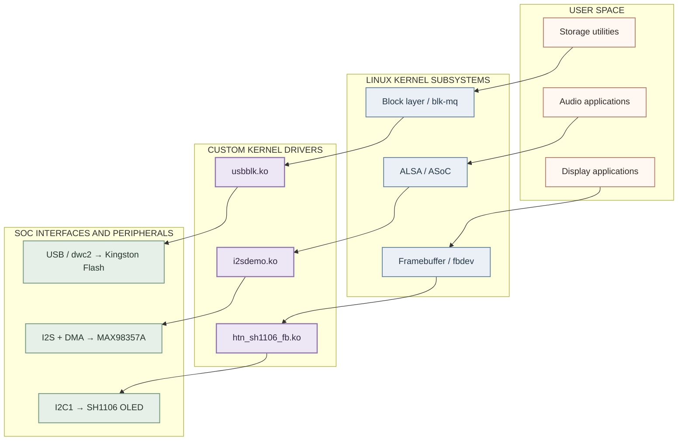
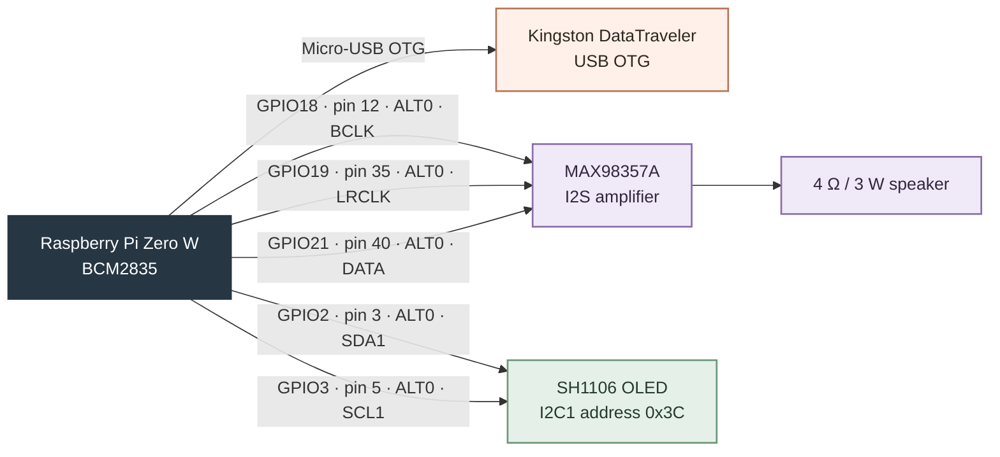
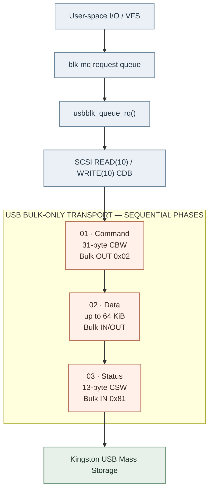
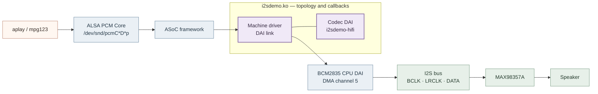
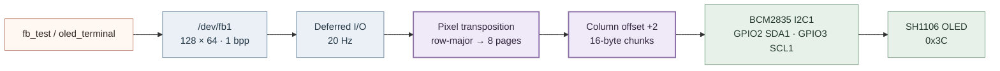

# SYSTEM REQUIREMENT & ARCHITECTURAL SPECIFICATION

**Project Title:** Custom Linux Out-of-Tree Kernel Drivers for USB Mass Storage (blk-mq BOT), ALSA Digital Audio (ASoC I2S), and Monochrome OLED Framebuffer (Deferred I/O)  
**Target Platform:** Raspberry Pi Zero W Rev 1.1 (Broadcom BCM2835 SoC, 1.0 GHz ARM1176JZF-S, 512 MB LPDDR2)  
**Target OS & Kernel:** Raspbian GNU/Linux, Linux Kernel Version 6.18.50+rpt-rpi-v6 (32-bit ARMv6Z)  
**Project Authors:** Nguyen Phi Lanh, Le Cong Quoc Anh, Phan Anh Khoa, Le Thanh Tai  
**Advisor:** M.Sc. Huynh Hoang Ha (Ho Chi Minh City University of Technology and Engineering)

---

## 1. System Architecture & Hardware Pin Allocation

This document specifies the technical requirements, hardware pinouts, kernel interface architectures, and operational principles for three custom out-of-tree Loadable Kernel Modules (LKMs) deployed on the Raspberry Pi Zero W platform.

### 1.1 System Architecture Overview

### 1.2 GPIO & Hardware Interconnect

**Power connections:** MAX98357A VIN/GND → physical pins **2 (5 V)** / **6 (GND)**; SH1106 VCC/GND → **1 (3.3 V)** / **9 (GND)**.

### 1.3 Complete Hardware Pinout Mapping

| Interface / Bus | Physical Pin # | SoC GPIO / Signal | Peripheral Pin | Electrical & Protocol Mode |
| :--- | :--- | :--- | :--- | :--- |
| **USB OTG Port** | Micro-USB | dwc2 OTG Controller | Kingston DT3.0 USB | USB 2.0 High-Speed (480 Mbps), BOT Protocol, VID 0x0951 PID 0x1666 |
| **I2S Digital Audio** | Physical Pin 12 | GPIO 18 / ALT0 (PCM_CLK) | MAX98357A BCLK | 1.536 MHz Bit Clock (48 kHz 16-bit Stereo PCM) |
| **I2S Digital Audio** | Physical Pin 35 | GPIO 19 / ALT0 (PCM_FS) | MAX98357A LRC (WS) | 48 kHz Word Select / Frame Sync Clock |
| **I2S Digital Audio** | Physical Pin 40 | GPIO 21 / ALT0 (PCM_DOUT) | MAX98357A DIN | Serial PCM Audio Data Line from BCM2835 I2S |
| **Audio Power Rail** | Physical Pin 2 | 5.0V Power Rail | MAX98357A VIN | 5.0 V DC Power Supply for Class-D Amplifier |
| **Audio Ground** | Physical Pin 6 | GND Rail | MAX98357A GND | Common System Ground Reference |
| **I2C OLED Display** | Physical Pin 3 | GPIO 2 / ALT0 (SDA1) | SH1106 OLED SDA | I2C1 Serial Data Line (Slave Address 0x3C, 100 kHz) |
| **I2C OLED Display** | Physical Pin 5 | GPIO 3 / ALT0 (SCL1) | SH1106 OLED SCL | I2C1 Serial Clock Line driven by BCM2835 Master |
| **OLED Power Rail** | Physical Pin 1 | 3.3V Power Rail | SH1106 OLED VCC | 3.3 V DC Logic / Panel Power Supply |
| **OLED Ground** | Physical Pin 9 | GND Rail | SH1106 OLED GND | Common System Ground Reference |

---

## 2. Subsystem Functional Specifications & Working Principles

### 2.1 Monolithic USB Mass Storage Block Driver (`usbblk.ko`)

The `usbblk.ko` subsystem shall integrate USB Bulk-Only Transport (BOT), a minimal SCSI translation engine, and Linux Multi-Queue Block Layer (`blk-mq`) dispatch in a single custom block-driver path.

- **USB Device Binding:** Binds directly to Kingston DataTraveler 3.0 (VID `0x0951`, PID `0x1666`, Class `0x08`, Subclass `0x06`, Protocol `0x50`).
- **SCSI Initialization Sequence:** Issues synchronous SCSI `TEST UNIT READY` (`0x00`), `REQUEST SENSE` (`0x03`), `INQUIRY` (`0x12`), and `READ CAPACITY(10)` (`0x25`) commands to discover device size (121,077,760 sectors x 512 B = 57.7 GiB).
- **Block Layer Registration:** Allocates a `blk-mq` tag set with 1 hardware queue (depth 16, `BLK_MQ_F_BLOCKING`), 64 KiB max transfer limit (128 sectors), and registers `gendisk` `/dev/usbblk0` and partition `/dev/usbblk0p1`.
- **CDB Protocol Engine:** Translates `blk-mq` `REQ_OP_READ` / `REQ_OP_WRITE` requests into 10-byte SCSI CDBs `READ(10)` (`0x28`) and `WRITE(10)` (`0x2A`) with big-endian sector LBA and transfer length conversion.
- **Write Protection Mechanism:** Enforces read-only protection by default (`allow_write=0`). Writes are permitted only when explicitly loaded with `allow_write=1`.
- **Hot-Unplug & Fault Recovery:** Handles physical hot-unplug via `dev->gone` flag, mutex lock protection, `del_gendisk()`, and BOT Reset Recovery (`0xFF` Control Request + `usb_clear_halt()`).

#### Storage Data Flow Diagram

---

### 2.2 Unified ALSA SoC Digital Audio Driver (`i2sdemo.ko` & `i2sdemo.dtbo`)

The `i2sdemo.ko` subsystem shall register the ASoC Codec Component (`student,i2sdemo-codec`) and Machine Driver (`student,i2sdemo-card`), linking BCM2835 I2S (`20203000.i2s`) and DMA Channel 5 to the MAX98357A Class-D amplifier.

- **Device Tree Overlay:** Device Tree overlay (`i2sdemo-overlay.dts`) enables `<&i2s_clk_producer>` and instantiates codec/card nodes.
- **ASoC Codec Component:** Registers Codec DAI `i2sdemo-hifi` supporting 8-96 kHz, 16/24/32-bit linear PCM (`S16_LE`, `S24_LE`, `S32_LE`), stereo/mono playback, and Speaker DAPM widget.
- **ASoC Machine Card:** Binds CPU DAI (`20203000.i2s`), Codec DAI (`i2sdemo-hifi`), and Platform DMA (`bcm2835-dma` Channel 5) in I2S Master Mode (`SND_SOC_DAIFMT_I2S | SND_SOC_DAIFMT_NB_NF | SND_SOC_DAIFMT_CBC_CFC`).
- **Kernel Stream Diagnostics:** Hooks `.hw_params` and `.trigger` callbacks to log audio stream parameters (rate, channels, bit width) and playback state (`START`/`STOP`) into `dmesg`.

#### Audio Data Flow Diagram

*The Codec DAI describes the audio endpoint; the BCM2835 I2S controller and DMA move the PCM samples.*

---

### 2.3 Monochrome OLED Framebuffer Driver (`htn_sh1106_fb.ko` & `htn-sh1106.dtbo`)

The `htn_sh1106_fb.ko` subsystem shall expose `/dev/fb1` through Linux fbdev for the 1.3-inch 128×64 SH1106 OLED connected over I2C1 at address `0x3C`.

- **Device Tree Binding:** `htn-sh1106-overlay.dts` enables `<&i2c1>` and binds `oled@3c` (`compatible = "htn,sh1106-fb"`) at 100 kHz I2C clock.
- **Panel Initialization:** Sends SH1106 initialization sequence over I2C: Display Off (`0xAE`), Clock Div (`0x80`), Multiplex 1/64 (`0x3F`), Segment Remap (`0xA1`), COM Scan (`0xC8`), Contrast (`0x80`), Charge Pump DC-DC (`0xAD`, `0x8B`), Display On (`0xAF`).
- **Framebuffer & Deferred I/O:** Allocates 1,024-byte virtual buffer (128x64, 1-bpp, `vzalloc`) and enables 20 Hz Deferred I/O (`FB_GEN_DEFAULT_DEFERRED_SYSMEM_OPS`) to trigger display updates on page fault.
- **Bit Transposition & Alignment:** Transposes row-major 1-bpp virtual buffer pixels into 8 vertical pages (Page Addressing `0xB0|page`), applies `HTN_COL_OFFSET = 2` to fix 2-pixel column shift on 132-column GDDRAM, and streams I2C payload in 16-byte chunks.

#### Graphics Rendering Diagram

---

## 3. Non-Functional Requirements & Safety Engineering

- **NFR-01 (DMA-Safe Memory Allocation):** All USB (CBW, CSW, sense, 64 KiB xfer) and I2C buffers are dynamically allocated in DMA-safe kernel heap via `kmalloc(..., GFP_KERNEL)`. Stack-allocated buffers are strictly prohibited.
- **NFR-02 (Concurrency & Synchronization):** USB transactions are synchronized via `struct mutex`. The `blk-mq` tag set uses `BLK_MQ_F_BLOCKING` to permit thread sleeping during `usb_bulk_msg()` I/O execution.
- **NFR-03 (Defensive Resource Cleanup):** Reverse-order `goto` unwinding labels (`err_disk`, `err_tag`, `err_vfree`) clean up resources on probe failure. Managed `devm_*` helpers ensure leak-free driver unbinding.
- **NFR-04 (Protocol Fault Recovery):** Bulk endpoints (`0x81` IN, `0x02` OUT) automatically issue USB BOT Reset Recovery (`0xFF` Control Request + `usb_clear_halt()`) upon STALL (`-EPIPE`) or bus errors.
- **NFR-05 (Performance & Parity):** Sustained 25.3-25.5 MB/s sequential read throughput (86.8% of stock `usb-storage`), 100% MD5 hash verification parity, 0 audio underruns (XRUNs=0, 1.2% CPU), and 20 Hz tear-free OLED rendering.

---

## 4. Verification & Traceability Matrix

| Req ID / Subsystem | Verification Test Suite | Empirical Measured Result | Status |
| :--- | :--- | :--- | :--- |
| **FR-BLK-01..04** *(USB Storage)* | 15-Case Test Suite & 40 Random LBA Reads | 121,077,760 sectors detected; 100% MD5 hash match with stock `/dev/sda` across all test samples | **PASS (100%)** |
| **FR-BLK-05..06** *(Storage Safe)* | `mkfs.fat`, File Write (`allow_write=1`), `fsck.fat` | `/dev/usbblk0p1` mounted; 4 files (10 MiB) written; `fsck.fat` verified clean; hot-unplug handled cleanly | **PASS (100%)** |
| **FR-SND-01..04** *(ALSA Audio)* | 48 kHz MP3 Playback via `mpg123` on `hw:i2sdemo,0` | Zero audio underruns (XRUNs = 0); ~1.2% CPU utilization; `dmesg` logged `rate=48000 ch=2 16-bit` & START/STOP | **PASS (100%)** |
| **FR-GFX-01..04** *(OLED Display)* | Bresenham Geometric Test (`fb_test`) & Terminal | `/dev/fb1` registered; crisp rendering of rectangles, diagonal X, and 5x7 ASCII text with zero offset artifacts | **PASS (100%)** |
| **NFR-01..05** *(System Parity)* | Sustained Direct-I/O Benchmark (64 MiB x 3) | 25.3-25.5 MB/s sustained read throughput (86.8% stock `usb-storage`); zero kernel memory leaks | **PASS (100%)** |
